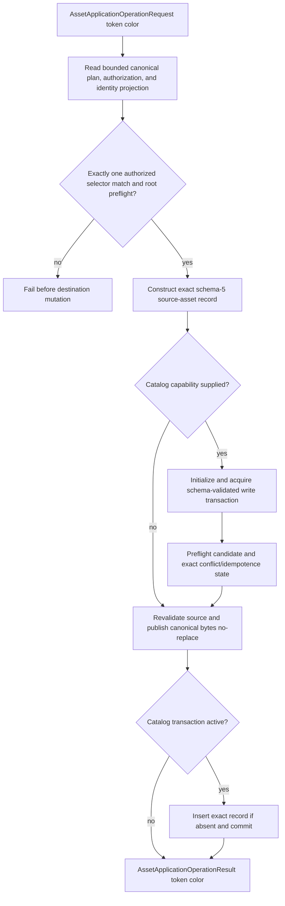

# Asset-application implementation

The semantic `asset.application` package owns one explicit spine:
`request.py`, `action.py`, and `result.py`, with the expected selection error in
`error.py`. Both `asset` and `asset.application` initializers are
documentation-only and provide no compatibility facade. The package directly
composes existing References-owned types and actions from `assets.py`,
`identity.py`, `catalog`, `models.py`, and `path_safety` without copying their
invariants.

With a catalog capability, `ReferenceCatalog.source_asset_recording_transaction`
holds `BEGIN IMMEDIATE` and validates the complete schema and candidate before
filesystem mutation. The transaction stays open through source revalidation
and no-replace publication. A catalog failure before publication leaves the
destination untouched. A failure after successful publication rolls back the
catalog but deliberately leaves the exact file for explicit replay
reconciliation because portable conditional inode-bound unlink is unavailable.
An exact retry observes identical destination bytes as unchanged and can finish
the catalog record. Conflicting bytes, stale plans, altered sources, authority
mismatches, schema changes, and record conflicts fail closed.

The CLI branch performs only argument adaptation, request construction, action
invocation, expected selection-error rendering, and path output. It does not
own plan parsing, authority validation, selection, catalog transaction, copy,
or reconciliation sequencing.

The operation does not grant identity, rights, scientific, manuscript, or
publication authority. `rights_status` is recorded evidence supplied by the
operator; the separate canonical-asset authorization remains mandatory and is
replayed unchanged. Schema 5 remains the sole catalog projection, with no dual
write or migration.
