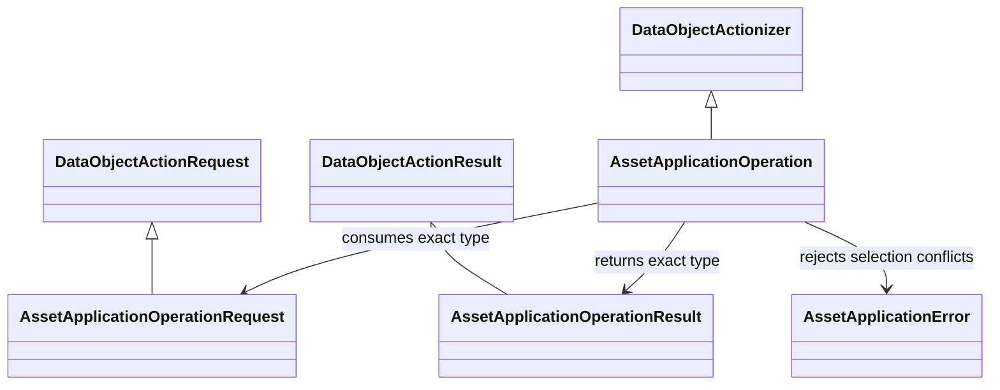

# Asset-application schematic

The owner operation is one indivisible transition binding. Internal authority
validation, catalog preflight and lock, filesystem publication, and catalog
recording are not exposed as reflectively inferred Workflow topology.
