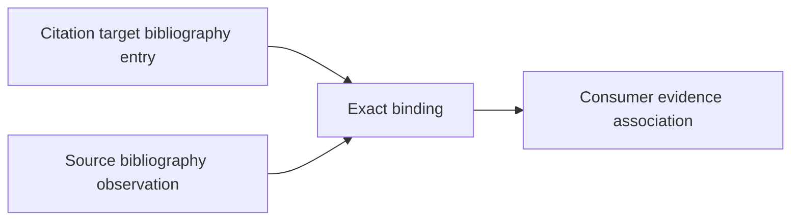

# Bibliography binding implementation

`CitationBibliographyObservationBinding` validates citekey, entry index, source
path, bibliography digest and size, verbatim-entry digest and size, and any
owner-supplied observation identity. The binding is immutable, replay-valid,
and accepted only as its exact canonical type.

The package depends on canonical citation target records and existing
References bibliography observations. It owns no accepted-reference,
document-processing, availability, receipt, or ingestion state.

- [Module index](index.md)
- [Schematic](schematic.md)
- source base: [`bibliography/base.py`](../../../../../src/python/projectkoios/references/bibliography/base.py)
