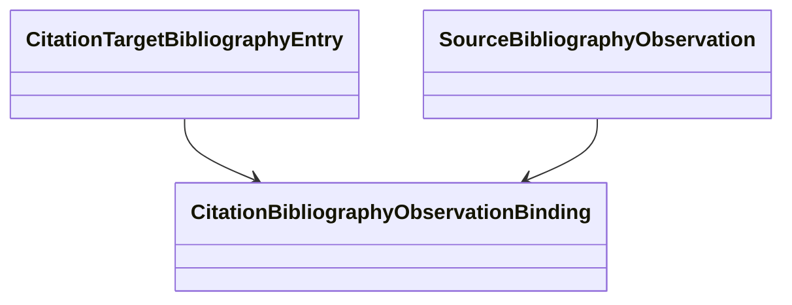

# Bibliography schematic

The binding preserves exact target and observation identities without deriving
accepted reference identity or document-processing state.

- [Module index](index.md)
- [Implementation](implementation.md)
- [Package index](../index.md)
