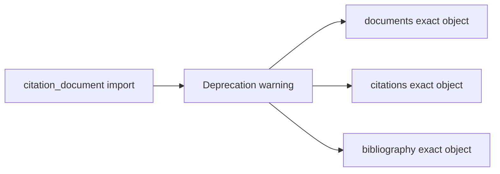

# Deprecated citation-document namespace implementation

The compatibility package defines no domain class and constructs no wrapper.
Its facade forwards attributes to their canonical owner and warns at most once
per name. Old submodules import canonical objects directly and warn when the
submodule is imported. Identity tests require `old is new`.

- [Module index](index.md)
- [Schematic](schematic.md)
- canonical [documents implementation](../documents/implementation.md)
