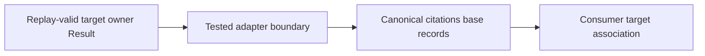

# Citation inventory implementation

The canonical implementations live in `citations/base.py`; target grammar,
resource ceilings, and stable identity construction live in the private
contract module. Every record is frozen, slotted, statically `final`, and
accepted at composition boundaries only by exact runtime type.

The package owns no bibliography observation, accepted reference identity,
document availability, receipt, or processing state. The live adapter evidence
and target-owner provenance are documented by the
[citation target contract](../../../../contracts/citation-document.md).

- [Module index](index.md)
- [Schematic](schematic.md)
- source base: [`citations/base.py`](../../../../../src/python/projectkoios/references/citations/base.py)
