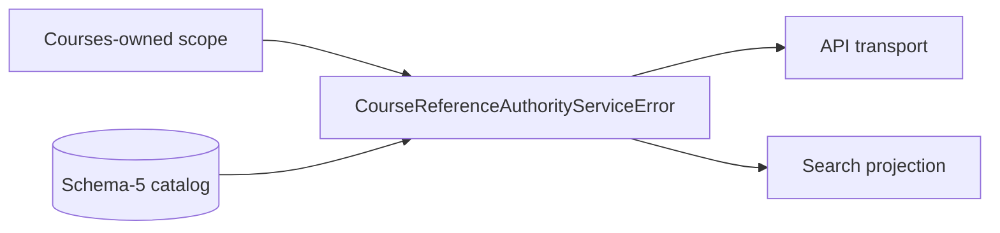

# CourseReferenceAuthorityServiceError: schematics

The diagram shows ownership and coordination only. References validates Courses evidence, owns authority decisions, and emits immutable results. API transports results without reconstructing authority.

- [Overview](index.md)
