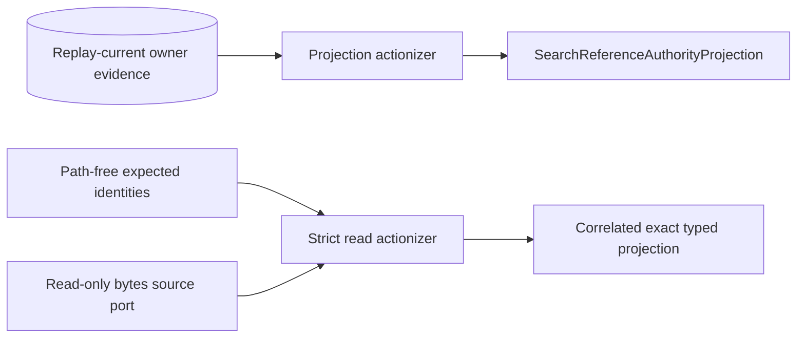

# courses.authority.search_projection: schematics

The producer emits the defining type. The read leaf verifies expected byte facts before strict canonical decoding and constructor-based identity reconstruction. It has no filesystem or catalog dependency.

- [Overview](index.md)
