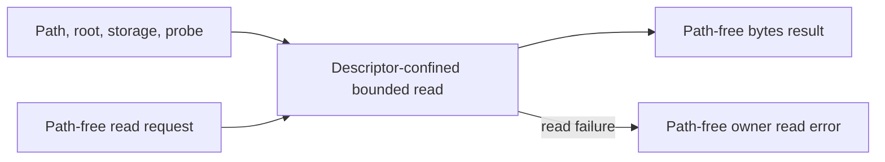

# FilesystemSearchReferenceAuthorityProjectionBytesReadActionizer: schematics

The adapter is read-only and supplies no decoding or authority interpretation. Path-safety and operating-system read failures are translated outside their active exception context, so the original path-bearing exception graph is not retained.

- [Overview](index.md)
