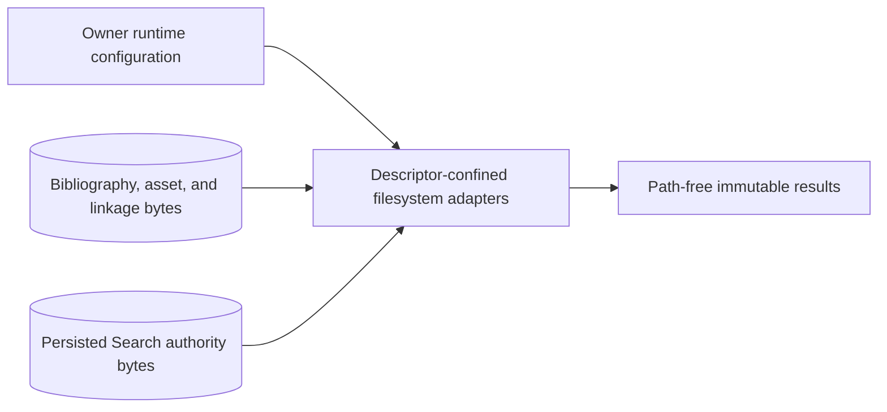

# courses.runtime.filesystem: schematics

Runtime paths, root aliases, storage classes, and placeholder probes remain constructor-injected capabilities. They never enter core requests, results, or content identities.

- [Overview](index.md)
