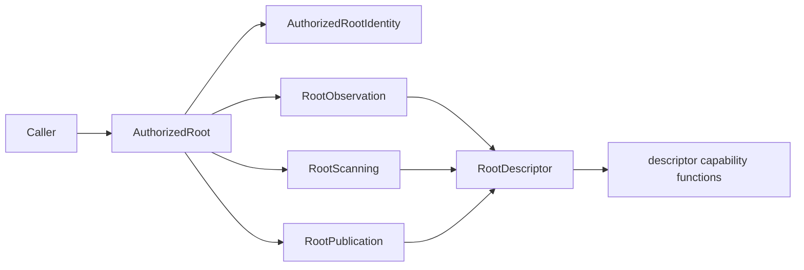

# `projectkoios.references.filesystem` implementation

The former `path_safety` aggregate has no compatibility package or export
facade. Maintained callers import the semantic owner module directly.

`AuthorizedRootIdentity` is a frozen value containing only the normalized root
path, reporting label, device/inode and mount identity, and immutable preflight
evidence. It does not retain a probe, descriptor, or operation capability.
`AuthorizedRoot` and each composed binding are frozen: identity, probe,
observation, scanning, publication, and descriptor bindings cannot be replaced
after authorization. `AuthorizedRoot` composes a shared `RootDescriptor` with
separate `RootObservation`, `RootScanning`, and `RootPublication`
collaborators. It does not inherit those operation roles.

Root-authorization functions bind identity; `RootDescriptor` only traverses and revalidates.
OS-specific mount, anonymous-file, clone/link, and no-replace rename primitives
live in Linux and macOS adapter modules. Descriptor traversal opens each
directory with `O_NOFOLLOW`, revalidates the root inode, and enforces device and
mount identity before leaf access. Strict listing and typed inventory traversal
are separate scanning actions. Publication separately owns directory creation,
anonymous staging, verified copying, and post-publication verification.
Cloud-backed access must pass metadata-only placeholder preflight before bytes
are opened. Publication is local-only, fsyncs staged bytes, and binds no-replace
publication to descriptors. The byte API is create-only; replacement, unsafe
rename, and unverifiable destructive rollback are absent from the capability.

Explicit-path read, observe, and write functions are adapters that authorize
the parent root and immediately perform the descriptor-confined operation.
The metadata-only `assert_safe_explicit_path` function was deleted.

## VVUQ classification

This test suite supplies bounded `software_verification` evidence only. It does
not establish `numerical_verification`, `scientific_validation`, or
`uncertainty_quantification`; this filesystem/citation slice contains no
numerical method, physical model, scientific reference comparison, or
uncertainty-propagation protocol.

## Software-verification command

Run the complete maintained suite from this worktree with:

```bash
PYTHONPATH=$PWD/src/python python -m pytest -q --disable-warnings
```

The implementation milestone completed with `467 passed`. These are routine,
unmarked software tests; they have not been admitted as formal claim-bearing
evidence with structured declaration records. Focused class-level software
verification is documented on the relevant class pages. In addition,
`test__removed_facades__are_not_public_api` in
`tests/package/projectkoios/references/filesystem/root/test__RootComposition.py`
proves that the old root exports are absent, while
`tests/test__ArchitectureDocumentation.py` proves that the `path_safety`
package is absent and semantic package initializers are Docstring-only.



[Back to package](index.md)
