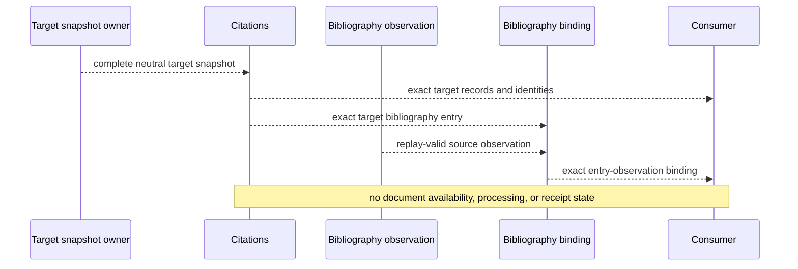

# `projectkoios.references` package implementation

The documented citation path preserves two independent owner boundaries:
complete neutral target citation inventory and exact bibliography observation
binding. Identity replay remains a separate References capability and does not
gate document processing.

The References root initializer is unchanged by these slices. Consumers import
citation inventory and bibliography bindings from their canonical focused
package facades. References defines no citation-document projection,
availability, processing, receipt, or target-association DTO in this slice.

Evidence:

- package source: [`src/python/projectkoios/references`](../../../../src/python/projectkoios/references)
- target adapter tests: [`test__CitationDocumentTargetAdapter.py`](../../../../tests/test__CitationDocumentTargetAdapter.py)

- [Package index](index.md)
- [Schematic](schematic.md)
