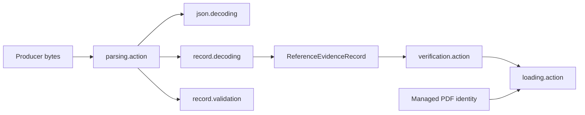

# Ingestion-evidence implementation

The former `projectkoios.references.ingestion_evidence` compound module is
removed. Immutable records, contract constants, strict JSON decoding, record
decoding, record validation, canonical serialization, source verification,
and managed-PDF loading now have semantic owner modules below
`projectkoios.references.ingestion.evidence`.

Package initializers contain docstrings only. Maintained callers import the
owner modules directly; no compatibility facade or root-package re-export
preserves the removed module.

Canonical JSON bytes, hashes, record identifiers, contract values, bounds,
error distinctions, source-identity checks, and filesystem confinement remain
unchanged. Evidence records are frozen and slotted. Explicit-path input accepts
either a bound placeholder probe or a root-binding probe factory, which the
authorized-root boundary binds before observation.

## VVUQ classification

This slice supplies bounded `software_verification` evidence only. It does not
establish `numerical_verification`, `scientific_validation`, or
`uncertainty_quantification`: it contains no numerical method, physical-model
comparison, or uncertainty-propagation protocol.

## Software-verification evidence

`tests/test__IngestionEvidence.py` verifies exact fixture identities, canonical
replay, deterministic bounds, semantic tamper rejection, source identity
binding, duplicate rejection, and CLI integration.

`tests/package/projectkoios/references/ingestion/evidence/test__ReferenceEvidencePathConfinement.py`
verifies citekey rejection, fail-closed symlink handling, and typed macOS probe
factory binding.
`test__IngestionEvidenceOwnership.py` verifies removal of the root-package
facade; `test__ArchitectureDocumentation.py` verifies removal of the old module.
