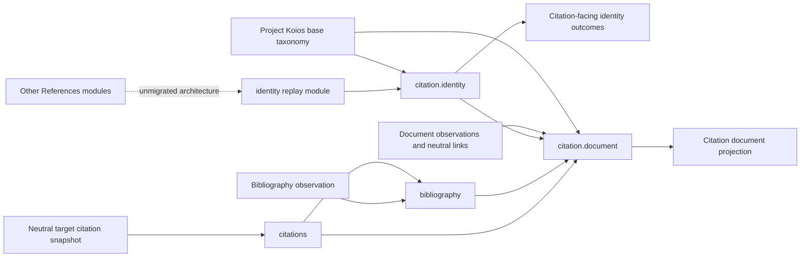

# `projectkoios.references` package schematic

This diagram expands only the modules migrated in the current vertical slices.
Untouched package modules remain opaque.

`citation.identity` reads immutable replay output. `citations` and
`bibliography` preserve target and evidence ownership; `citation.document`
composes those records with document evidence. None of these modules
introduces identity promotion, rights, review, use, or ingestion authority.

- [Package index](index.md)
- [Implementation](implementation.md)
