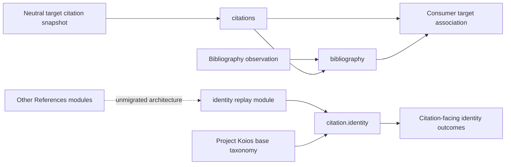

# `projectkoios.references` package schematic

This diagram expands only the modules migrated in the current vertical slices.
Untouched package modules remain opaque.

`citation.identity` reads immutable replay output. `citations` preserves exact
target-owned records, while `bibliography` binds an exact target bibliography
entry to exact References evidence. Neither package owns citation-document
processing, receipts, availability, rights, review, use, or ingestion authority.

- [Package index](index.md)
- [Implementation](implementation.md)
